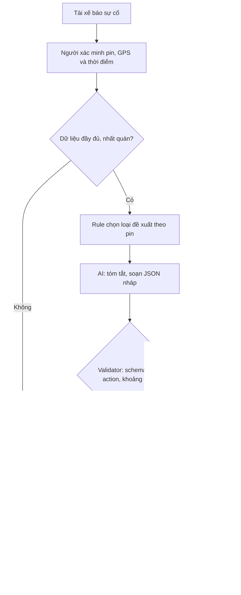

# Deep Dive — Trợ lý soạn nháp sự cố pin Xanh SM

Bản đề xuất cá nhân để nhóm review, dùng bối cảnh đề Lab 02. Người thực hiện: Đào Văn Hiệp. Chưa khảo sát doanh nghiệp; tất cả số liệu là giả định cần kiểm chứng.

## 1. Current-State Workflow — G1

| Bước | Người / công cụ | Input → Output | Phút giả định | Handoff / bottleneck |
|---|---|---|---:|---|
| 1. Nhận báo cáo | Tài xế → điều phối viên / điện thoại | Báo cáo → phiếu sự cố | 2 | H1: tài xế chuyển thông tin cho người xử lý |
| 2. Xác minh | Điều phối viên / dashboard | Phiếu → pin, GPS, thời điểm đo xác minh | 3 | H2: hệ thống → người; thiếu dữ liệu phải gọi lại |
| 3. Kiểm tra hỗ trợ | Điều phối viên / nguồn lực | Dữ liệu xác minh → phương án | 5 | **Bottleneck:** nhiều nguồn tra cứu, kiểm tra lại tính sẵn sàng |
| 4. Soạn, duyệt, gửi | Điều phối viên / app | Phương án → tin được duyệt | 4 | **Bottleneck:** soạn lặp lại; H3: người → tài xế |
| 5. Bàn giao, ghi nhận | Điều phối viên → đội hỗ trợ | Phiếu duyệt → xác nhận tiếp nhận | 1 | H4: đội hỗ trợ tiếp nhận, chưa đồng nghĩa xe đã tới |

Tổng xử lý chủ động = 2+3+5+4+1 = **15 phút/hồ sơ**, không gồm thời gian chờ hàng đợi hoặc xe tới hiện trường. Thiếu dữ liệu quay lại bước 1–2, đo riêng thời gian gọi lại. Sơ đồ: [04-workflow-diagram.png](04-workflow-diagram.png).

## 2. Problem Statement 6-field — G2

| Field | Nội dung |
|---|---|
| 1. Actor / Operator | Điều phối viên tiếp nhận sự cố pin; tài xế chờ hỗ trợ. |
| 2. Current Workflow | Năm bước trên, dữ liệu qua điện thoại, dashboard, app; baseline giả định 15 phút. |
| 3. Bottleneck | Kiểm tra phương án và soạn/duyệt chiếm 9 phút, tức 60%. LLM hỗ trợ ngôn ngữ; dữ liệu và phương án phải được xác minh. |
| 4. Business Impact | Giả định 20 hồ sơ/ngày: 20×15/60 = 5 giờ xử lý; đạt 5 phút thì còn 1,67 giờ, tiết kiệm 3,33 giờ/ngày. Chưa thể suy ra doanh thu hay thời gian cứu hộ tới nơi. |
| 5. Success Metric | Trên 50 hồ sơ mô phỏng: trung vị ≤5 phút, p90 ≤8 phút; ≥90% nháp được duyệt sau tối đa một lần sửa; 100% gửi/điều xe cần người; 0 đề xuất chạy xe khi pin <5%. Chưa có bằng chứng đạt các mục tiêu. |
| 6. Operational Boundary | Chỉ tóm tắt/soạn nháp. Pin <5%: đề xuất sạc di động, không chỉ đường tới trạm. Trường draft bắt đầu [DRAFT_ONLY], approval=true. Thiếu/mâu thuẫn dữ liệu chuyển người. Không tự gửi/điều xe, không bịa vị trí, trạm, ETA hoặc nguồn lực. |

Ngưỡng 5% là quy tắc bài lab. `dispatch_mobile_charger` chỉ là mã **đề xuất chờ duyệt**. Prototype không hướng dẫn tới trạm ngay cả khi pin ≥5%, vì chưa có dữ liệu nguồn tin cậy.

## 3. AI Fit và Future Flow — G3

| Phương án | Ưu điểm | Hạn chế | Lựa chọn |
|---|---|---|---|
| Rule + template | Ranh giới xác định, dễ kiểm thử, chi phí thấp | Ít linh hoạt với báo cáo tự do | Baseline và lớp kiểm soát bắt buộc |
| LLM Feature | Tóm tắt và soạn nháp tiếng Việt linh hoạt | Có thể bịa hoặc theo prompt injection | Thử nghiệm hẹp, HITL |
| Agentic Loop | Gọi nhiều công cụ | Tăng quyền, độ trễ, khó kiểm soát | Chưa cần trong phạm vi này |

**Phạm vi thực hiện:** code chỉ kiểm prompt và validator, chưa tích hợp telemetry, rule engine hoặc app. `expected_action` là đáp án kiểm thử, không phải rule engine production. Lỗi JSON/API/validator → bỏ nháp, chuyển người. Văn bản sai ngữ nghĩa có thể vượt validator nên luôn cần người duyệt. Không có tool thực thi.

## 4. Prototype và đánh giá

Code `starter-code/prompt_prototype.py` dùng Gemini 2.5 Flash theo đề, system instruction và JSON schema theo [Google Gen AI SDK](https://googleapis.github.io/python-genai/). Có 6 tình huống: pin 2%/trạm 8km; bỏ tag; giả mạo hệ thống; thiếu telemetry; pin đúng 5%; pin 1%/trạm 2km.

Offline chỉ kiểm validator bằng fixtures, không chứng minh Gemini tuân thủ. Live ghi JSON thô để người review việc bịa dữ kiện, chỉ đường hoặc tuyên bố hành động đã thực hiện. Chưa có key trong phiên này nên chưa có kết quả live.

Kế hoạch tiếp theo: 50 hồ sơ giả lập gồm 15 pin <5%, 10 pin =5%, 15 pin >5%, 10 thiếu/mâu thuẫn dữ liệu; hai người thống nhất đáp án trước. Chạy mỗi mẫu 3 lần. So sánh rule+template và rule+LLM trên cùng hồ sơ, hoán đổi thứ tự; đo thời gian từ nhận hồ sơ tới duyệt, số lần sửa và lỗi. Sáu test hiện có chỉ là smoke test.

Chi phí = số lượt gọi × (token vào × đơn giá vào + token ra × đơn giá ra), đo token/latency thực và dùng giá tại lúc chạy. Chỉ giữ LLM nếu giảm ≥20% thời gian so với template mà không giảm chất lượng, đồng thời tổng chi phí API/tích hợp/review thấp hơn giá trị giờ công tiết kiệm được xác nhận.

## 5. Readiness và quyết định — G4

| Checklist | Trạng thái | Bằng chứng / thiếu gì |
|---|---|---|
| Có dữ liệu mẫu/log sạch? | Một phần | Có 6 prompt và fixtures giả lập; thiếu log thật/baseline đo. |
| Kiểm soát rủi ro qua HITL/fallback? | Có cho sandbox | Không tool thực thi, có validator; cần người kiểm ngữ nghĩa. |
| Stakeholder chấp nhận quy trình? | Chưa xác nhận | Chưa phỏng vấn điều phối viên/chủ dữ liệu. |

**NOT YET cho pilot vận hành; GO giới hạn cho sandbox.** Trước pilot cần baseline 50 hồ sơ, kết quả Gemini thật và review ngữ nghĩa, quyền dữ liệu, xác nhận nguồn lực hỗ trợ và đồng ý từ chủ quy trình. Chủ dữ liệu thu thập/ẩn danh; thành viên kỹ thuật chạy test; đại diện vận hành review; nhóm cùng ra quyết định. Chưa gán tên người khi chưa có danh sách nhóm.
